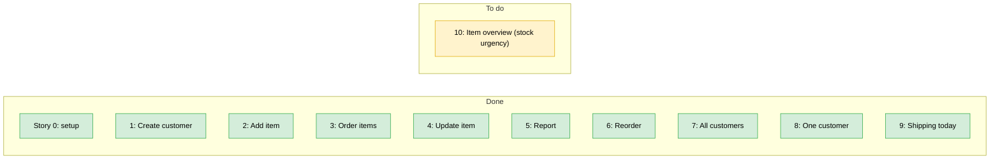
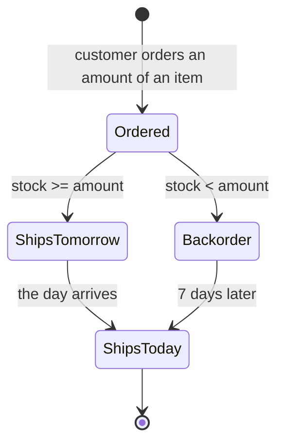
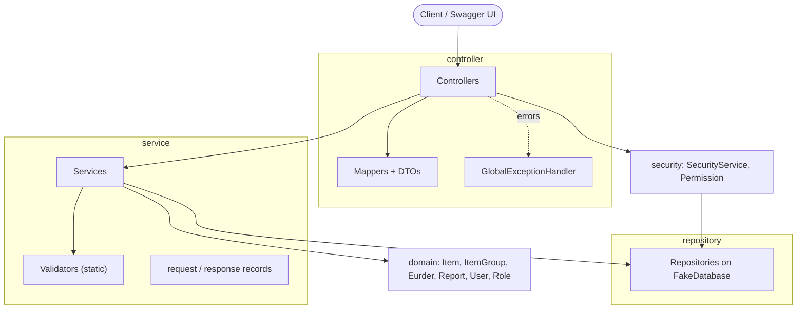
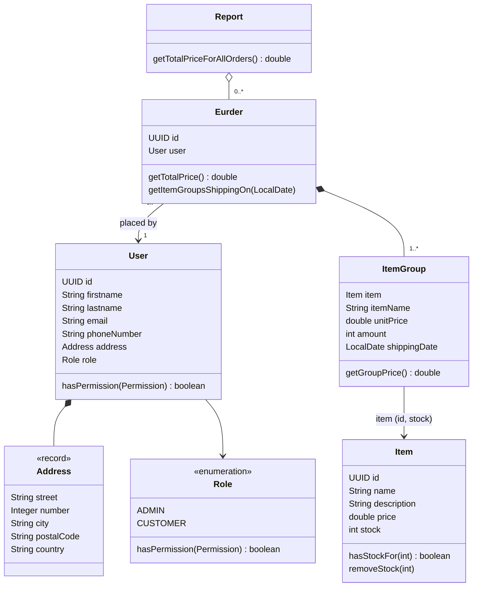
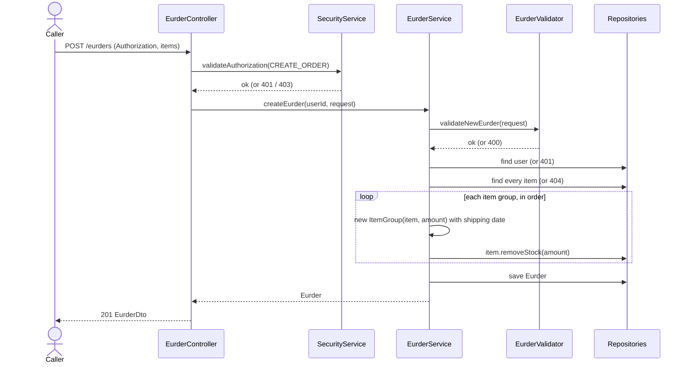

# Eurder – Part 1: REST API (in-memory)

> State of the project **after the refactoring**, before the database / ORM part.
> Code links are relative to this file. Story texts: [project_infos/README.md](../README.md).

**Quick facts**

| | |
|---|---|
| Stack | Java 25, Spring Boot 4.1.1, Maven, springdoc (Swagger UI) |
| Storage | In memory ([FakeDatabase](../../src/main/java/com/application/eurder_project/repository/FakeDatabase.java)), empty at start-up |
| Authentication | `Authorization` header = the **UUID of a user** (placeholder, a real auth service comes later) |
| Run | `./mvnw spring-boot:run`, Swagger UI at `http://localhost:8080/swagger-ui.html` |
| Test | `./mvnw clean test` (`./mvnw verify` also checks 80 % line coverage) |

---

## 1. Story status



After story 10: the ORM / PostgreSQL part, see [section 9](#9-prepared-for-the-orm).

### Lifecycle of an item group (shipping state)

An order line (`ItemGroup`) only stores a **shipping date**. There is no "shipped" status yet.



---

## 2. Architecture



| Package | Role | Main classes |
|---|---|---|
| [controller](../../src/main/java/com/application/eurder_project/controller) | HTTP endpoints, checks permission, maps domain to DTO | [EurderController](../../src/main/java/com/application/eurder_project/controller/EurderController.java), [ItemController](../../src/main/java/com/application/eurder_project/controller/ItemController.java), [UserController](../../src/main/java/com/application/eurder_project/controller/UserController.java), [ReportController](../../src/main/java/com/application/eurder_project/controller/ReportController.java) |
| controller/dto, controller/mapper | Response shapes and domain → DTO conversion | `*Dto`, `*Mapper` |
| controller/exception | Exception → HTTP status + log | [GlobalExceptionHandler](../../src/main/java/com/application/eurder_project/controller/exception/GlobalExceptionHandler.java) |
| [security](../../src/main/java/com/application/eurder_project/security) | Who is calling and what may they do | [SecurityService](../../src/main/java/com/application/eurder_project/security/SecurityService.java), [Permission](../../src/main/java/com/application/eurder_project/security/Permission.java) |
| [service](../../src/main/java/com/application/eurder_project/service) | Business logic | [EurderService](../../src/main/java/com/application/eurder_project/service/EurderService.java), [ItemService](../../src/main/java/com/application/eurder_project/service/ItemService.java), [UserService](../../src/main/java/com/application/eurder_project/service/UserService.java), [ReportService](../../src/main/java/com/application/eurder_project/service/ReportService.java) |
| service/validator | Checks the **shape** of a request (no repository access) | [ValidationUtils](../../src/main/java/com/application/eurder_project/service/validator/ValidationUtils.java), [ItemValidator](../../src/main/java/com/application/eurder_project/service/validator/ItemValidator.java), [UserValidator](../../src/main/java/com/application/eurder_project/service/validator/UserValidator.java), [EurderValidator](../../src/main/java/com/application/eurder_project/service/validator/EurderValidator.java) |
| service/request, service/response, service/mapper | Input records, the `ShippedToday` result, [ReorderMapper](../../src/main/java/com/application/eurder_project/service/mapper/ReorderMapper.java) | |
| [domain](../../src/main/java/com/application/eurder_project/domain) | Business objects | see section 3 |
| [repository](../../src/main/java/com/application/eurder_project/repository) | In-memory storage | [FakeDatabase](../../src/main/java/com/application/eurder_project/repository/FakeDatabase.java) + 3 repositories |

**Rules of the design**
- Validators only check the request. "Does it exist?" is checked in the service, because that needs a repository.
- Services have at most 3 constructor parameters.
- A controller first calls `SecurityService.validateAuthorization(...)`, then the service.

### Permissions

| Permission | ADMIN | CUSTOMER |
|---|:-:|:-:|
| VIEW_ALL_USERS, VIEW_USER_BY_ID, CREATE_USER | ✅ | |
| CREATE_ITEM, UPDATE_ITEM | ✅ | |
| VIEW_ALL_ORDERS, VIEW_ORDERS_BY_USER, VIEW_ALL_SHIPPING_TODAY | ✅ | |
| CREATE_ORDER, VIEW_MY_REPORT | ✅ | ✅ |
| VIEW_MY_ORDERS | | ✅ |

Defined in [Role](../../src/main/java/com/application/eurder_project/domain/user/Role.java). `GET /items` and `GET /items/{id}` need no authorization.

---

## 3. Class diagram (domain)



Notes: `itemName` and `unitPrice` in `ItemGroup` are a **snapshot** taken at order time. `Item`, `User` and `Eurder` are equal when their `id` is equal. Sources: [domain](../../src/main/java/com/application/eurder_project/domain).

---

## 4. Logic choices per story

### Story 0: Setup and technical requirements
- Layers and package names as in section 2. The word *order* is never used in code (reserved in PostgreSQL), always **eurder**.
- Every handled error is logged with `logger.warn` in the [GlobalExceptionHandler](../../src/main/java/com/application/eurder_project/controller/exception/GlobalExceptionHandler.java).
- OpenAPI/Swagger annotations on the controllers; the `Authorization` header is documented as an API key ([SwaggerConfig](../../src/main/java/com/application/eurder_project/SwaggerConfig.java)).
- Tests: service tests (plain JUnit) and controller tests (RestAssured on a random port). Controller tests insert their own admin, because no admin exists at start-up.

### Story 1: Create a customer account
- `POST /users`, only for ADMIN. Registration by unregistered users will be a **separate auth service** with its own request body.
- The role comes from the request body.
- Rules ([UserValidator](../../src/main/java/com/application/eurder_project/service/validator/UserValidator.java)): first name, last name, e-mail, phone, street, number, postal code, country and role are required. **City is optional.**
- E-mail must match a pattern **and be unique** (case-insensitive) → otherwise 409. Checked in [UserService](../../src/main/java/com/application/eurder_project/service/UserService.java).
- Phone: optional `+`, then 8–15 digits. Spaces, dots and dashes are allowed (`+32 470 12 34 56`). Stored as sent.

### Story 2: Add an item
- `POST /items`, ADMIN only. Name and description required, **price > 0 and stock > 0** (never 0 at creation). See [ItemValidator](../../src/main/java/com/application/eurder_project/service/validator/ItemValidator.java).

### Story 3: Order items
- `POST /eurders`, ADMIN or CUSTOMER. The order belongs to the caller.
- **Shipping date per item group** ([ItemGroup](../../src/main/java/com/application/eurder_project/domain/ItemGroup.java)): stock ≥ amount → tomorrow, otherwise today + 7 days.
- **Total price** = sum of the group prices (`amount × unitPrice`), calculated, never stored.
- **Price question from the story:** an order line keeps a *reference* to the item (for id and stock) **and a copy of its name and unit price**. Changing the item later never changes old orders.
- **Stock** is reduced by the ordered amount, **group by group**. The same item twice in one order is checked against the stock left by the first group.
- **Backorder:** ordering more than the stock is allowed and the stock goes **negative**. See [section 8](#8-alternative-stock-never-below-0) to forbid negative stock.
- Order of checks in [EurderService](../../src/main/java/com/application/eurder_project/service/EurderService.java): request shape (400) → caller exists (401) → all items exist (404) → stock changes.

### Story 4: Update an item
- `PUT /items/{id}`, ADMIN only. Only the filled-in fields change, the **id never changes**.
- Blank name or description = "not sent". Price must be > 0. **Stock may be set to 0.**
- Unknown id gives 404 before the body is validated.

### Story 5: Report of orders
- `GET /report`: the caller's own eurders (with item groups and totals) plus the total of all orders. A user without orders gets an empty list and total 0. See [ReportService](../../src/main/java/com/application/eurder_project/service/ReportService.java).

### Story 6: Reorder
- `POST /eurders/my-eurders/re-eurder/{id}`. Only the caller's own eurders are searched: someone else's or an unknown id is **404** (no information leak).
- The new order is a normal order built from the old item ids and amounts, so it uses the **current price and current stock**.

### Story 7 and 8: View customers
- `GET /users` and `GET /users/{id}`, ADMIN only. Unknown id → 404. The address is returned as `AddressDto`.

### Story 9: Items shipping today
- **Customer:** `GET /eurders/my-eurders/today` → the caller's item groups whose date is today, plus the caller's address.
- **Admin:** `GET /eurders/shipping-today` → **one entry per eurder** with its item groups shipping today and that customer's address. Eurders with nothing today are left out.
- Groups of one eurder with different dates are split: only today's groups are returned.

### Story 10: Item overview
- Not started (planned after the refactoring).

---

## 5. Request flow per endpoint

Every secured endpoint starts with: *Authorization header → known user? (401) → has permission? (403)*.

| Endpoint | Permission | Flow | OK | Other results |
|---|---|---|---|---|
| `POST /users` | CREATE_USER | validate → email unique → save user | 201 | 400, 409 |
| `GET /users` | VIEW_ALL_USERS | all users → DTOs | 200 | |
| `GET /users/{id}` | VIEW_USER_BY_ID | find user | 200 | 404 |
| `GET /items` | none | all items | 200 | |
| `GET /items/{id}` | none | find item | 200 | 404 |
| `POST /items` | CREATE_ITEM | validate → save item | 201 | 400 |
| `PUT /items/{id}` | UPDATE_ITEM | find item → validate → apply filled-in fields → save | 200 | 400, 404 |
| `POST /eurders` | CREATE_ORDER | see sequence below | 201 | 400, 404 |
| `POST /eurders/my-eurders/re-eurder/{id}` | CREATE_ORDER | find own eurder → map to request → create eurder | 201 | 404 |
| `GET /eurders` | VIEW_ALL_ORDERS | all eurders | 200 | |
| `GET /eurders/user/{id}` | VIEW_ORDERS_BY_USER | user exists → eurders of that user | 200 | 404 |
| `GET /eurders/my-eurders` | VIEW_MY_ORDERS | caller's eurders | 200 | |
| `GET /eurders/my-eurders/today` | VIEW_MY_ORDERS | caller's groups shipping today + address | 200 | |
| `GET /eurders/shipping-today` | VIEW_ALL_SHIPPING_TODAY | per eurder: groups shipping today + address | 200 | |
| `GET /report` | VIEW_MY_REPORT | caller's eurders → report | 200 | |

401 and 403 apply to every secured endpoint. A path id that is not a UUID gives 400.



---

## 6. Exceptions

| Exception | HTTP | Thrown when | Thrown in |
|---|:-:|---|---|
| [RequestException](../../src/main/java/com/application/eurder_project/service/exception/RequestException.java) | 400 | A required field is missing or blank, a field is invalid (e-mail, phone, address), a number is negative or not greater than 0 | validators |
| [ExistenceException](../../src/main/java/com/application/eurder_project/service/exception/ExistenceException.java) | 404 | Item, user or eurder not found. Message: "This item is not found in the database." | services |
| [UnauthorizedException](../../src/main/java/com/application/eurder_project/security/UnauthorizedException.java) | 401 | No `Authorization` header, unknown user id, unknown user when creating an eurder | SecurityService, EurderService |
| [ForbiddenException](../../src/main/java/com/application/eurder_project/security/ForbiddenException.java) | 403 | The user's role lacks the permission | SecurityService |
| [ConflictException](../../src/main/java/com/application/eurder_project/service/exception/ConflictException.java) | 409 | E-mail already in use | UserService |
| `MethodArgumentTypeMismatchException` (Spring) | 401 / 400 | 401 if the **Authorization header** is not a UUID, 400 for any other value that is not a UUID (e.g. in the path) | Spring, handled in GlobalExceptionHandler |

Not customized: a malformed JSON body gives Spring's default 400. All responses use `{"message": "..."}` except that default.

---

## 7. Edge cases that are handled

**Security**
- Header missing, unknown id, not a UUID → 401. Known user without permission → 403.
- A customer cannot reorder or see someone else's eurder (404).

**Users**
- Blank names, bad e-mail, bad phone, missing address part, missing role → 400.
- Same e-mail in another letter case → 409.
- City missing is accepted.

**Items**
- Create: price 0 or stock 0 → 400 (also negative or missing).
- Update: partial body, blank texts ignored, stock 0 allowed, price 0 or negative stock → 400, unknown id → 404.
- Updating an item does not change existing orders (name and unit price are copied).

**Eurders**
- Null or empty item list, null group, null item id, amount 0 or negative → 400.
- Unknown item → 404 and **no stock was changed** (items are all checked before any stock change).
- Amount equal to the stock → ships tomorrow. Amount above the stock → ships in 7 days, stock becomes negative.
- Same item twice: the second group sees the stock left by the first.
- Reorder after the price changed → new price. Reorder after the item was deleted → 404.

**Shipping today**
- Nothing ships today → empty items (customer) or empty list (admin).
- Customers never see other customers' groups.

---

## 8. Alternative: stock never below 0

The current behaviour is **backorder**: stock can go negative. To keep stock at 0 or above, change one line in [Item.removeStock](../../src/main/java/com/application/eurder_project/domain/Item.java):

```java
// now (backorder, stock can become negative)
public void removeStock(int amount) {
    stock -= amount;
}

// alternative (stock stops at 0)
public void removeStock(int amount) {
    stock = Math.max(0, stock - amount);
}
```

The shipping dates do not change (they only look at `hasStockFor`). Tests to adapt: `EurderServiceTest` (`...TheStockGoesNegative`, `...usesUpTheStock...`) and `EurderControllerTest.createEurder_withTheSameItemTwice_...` expect negative values.

---

## 9. Prepared for the ORM

What was done so that switching to JPA / PostgreSQL is smaller:
- `FakeDatabase` is the only in-memory class. Repositories expose `save`, `get`, `getAll` plus two small queries (`getByUserId`, `existsByEmailIgnoreCase`) that map to Spring Data method names.
- Entities compare on `id` only.
- `ItemGroup` already carries its own `itemName` and `unitPrice` (columns on the order line).
- `Eurder.getTotalPrice()` and `ItemGroup.getGroupPrice()` are calculated, not stored.
- Validation does not depend on repositories.

To do when adding the ORM (not done yet):
- Entity annotations, no-arg constructors, relations (`User` → `Address`, `Eurder` → `ItemGroup` → `Item`).
- Remove `FakeDatabase.reset()` and `deleteWithId()` (test only) and clean tests with the repository (`deleteAll`).
- Seed an admin account (none exists at start-up).
- `Role` and `Permission` stay in code; only the role is stored.
